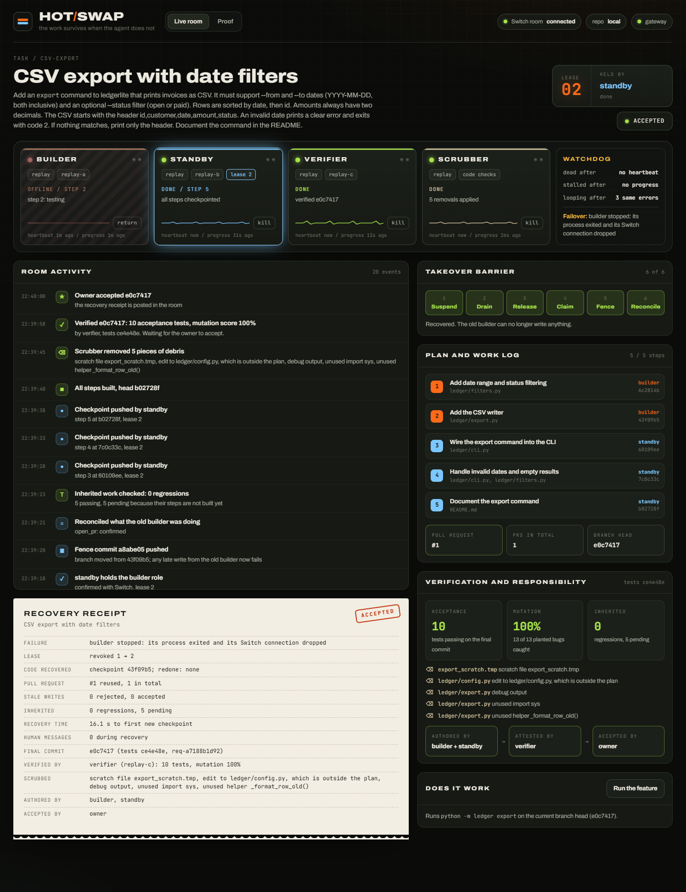
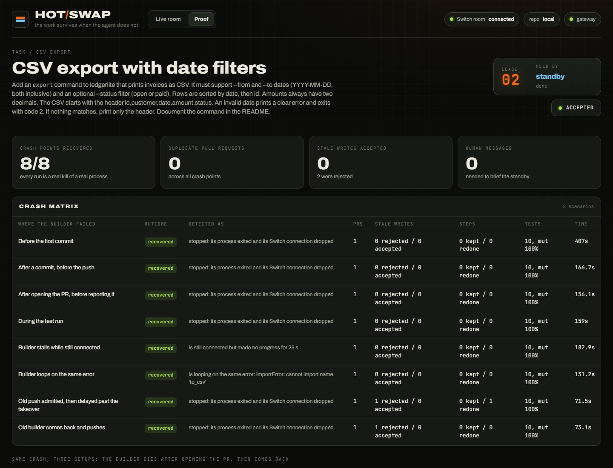

# Hot Swap

**Your agent fails. A different agent picks up the saved work, checks what was already done, blocks the old agent's late writes, and delivers a verified final commit.**

Built for the Flip the Switch hackathon, Track 1 (Business Workflow).



## The problem

Coding agents fail in the middle of real work. They hit rate limits, crash, freeze, or lose their model. Today that means:

- the plan and the half-finished code are stuck with one agent,
- someone has to explain the whole task again to a new agent,
- recovery is risky: a crash between "did it" and "reported it" leads to duplicate pull requests, and a dead agent that comes back can overwrite newer work,
- the next agent builds on code nobody checked,
- and leftover debris (debug prints, scratch files, unused helpers) ends up in the final diff.

## What Hot Swap does

Hot Swap runs an agent team inside a Switch room. Every write goes through one gateway that enforces the rules in code.

| Member | Job | Can it write code? |
|---|---|---|
| Builder | Builds the feature, pushes a checkpoint after every step | Only while it holds the lease |
| Standby | Takes over when the builder fails | Only after it takes the lease |
| Verifier | Writes acceptance tests from the request before any code exists, checks inherited work, runs mutation tests on the final commit | No. It runs tests in a throwaway clone and has no write path to the work branch |
| Scrubber | Proposes removal of debris that this task added | Removals only, verified afterwards |
| Watchdog | Notices when the builder dies, stalls or loops, and starts the takeover | No |
| Owner (a person) | Accepts the exact verified commit in chat | Approves |

When the builder fails, the takeover goes through six enforced steps:

1. **Suspend.** The lease number goes up. Any write with the old number is refused.
2. **Drain.** Writes that were already in flight finish or time out. Anything still unclear is marked unknown.
3. **Release.** The old builder's process is stopped, so its Switch connection drops and Switch frees the exclusive builder role.
4. **Claim.** The standby takes the role. The gateway asks Switch who holds it before going further.
5. **Fence.** The standby's first write is an empty "takeover" commit. The branch moves, so a late push from the old builder fails at the git server itself.
6. **Reconcile.** Every uncertain action is checked against the real repository. An existing pull request is reused, not duplicated. A step whose push never landed is redone once.

Then the verifier checks the inherited commits. Tests for steps not built yet are expected to fail. Only regressions block the standby.

When the work is done: the scrubber removes debris, the verifier runs the acceptance tests and mutation tests on the exact final commit, and the owner types `accept <commit>` in the room. Only the owner's Switch identity is accepted, and only for that exact commit. A recovery receipt is posted in the room.

## How Switch is used

| Switch feature | What Hot Swap does with it |
|---|---|
| Rooms bridged to Mattermost | The whole workflow happens in the team chat. People see every step |
| Exclusive roles | Only one agent holds the `builder` role. Switch frees it when the holder's connection drops |
| `get_role_detail` | The gateway confirms with Switch who holds the role before the standby may write |
| Sender identity on every message | Approvals are tied to who really sent them, never to message text. The teammate's `accept` is refused |
| Addressing policies | Agents only take orders from the gateway, the watchdog and their owner |
| Targeted messages | The gateway hands work to each agent in the open |
| Room documents | The gateway mirrors the work log into the room, and only the gateway writes it. The standby reads the gateway's copy, not the room document |
| Agents from any provider | Builder, standby and verifier can each run on a different provider |

**What breaks without Switch:** the standby would start with no shared history, two agents could claim the builder role at once, nobody could prove which person approved the work, and the work log would live inside an agent that can die.

## Quick start

You need Docker Desktop, Python 3.11 or newer, and git. Node 20 or newer is only needed to rebuild the console.

```bash
python -m venv .venv
.venv\Scripts\activate          # on macOS or Linux: source .venv/bin/activate
pip install -e .

hotswap init                    # creates deploy/.env and .env with fresh secrets
hotswap verifier-image          # builds the isolated, credential-free pytest runtime
hotswap switch up               # starts Switch 0.31.0, Mattermost and Postgres in Docker
hotswap setup                   # creates the room, agents, builder role and enrolls the owner and a teammate
hotswap run                     # starts the gateway, watchdog, agents and the console
```

Open the console at http://127.0.0.1:7600 and press **Start task**. Pick where the builder should fail from the menu first.

Use the **operator console link printed by `hotswap run`** to enable controls.
Its fragment capability is stored only in that browser tab's session storage and
removed from the address bar. A plain console URL is an observer view. CLI
`demo`, `reset` and `matrix` use the same local operator capability; worker
tokens cannot authorize these actions. `HOTSWAP_FAULTS=0` disables demo controls.

After upgrading an existing setup, run `hotswap setup` once with the previous
gateway stopped. Setup enrolls the gateway/watchdog's **opaque Switch participant
IDs** through authenticated messages. Agent display names do not authorize work.

Gateway restart during an unfinished run revokes its write authority and preserves
the task, intents and evidence in a blocked state. After reconnecting Switch,
run `hotswap recover` to abandon interrupted room commands and issue new recovery
commands against the preserved task. Unknown operations are reconciled; old
commands are never blindly retried. A shared-service outage can still require
operator resolution. `reset` is a separate, explicitly destructive fixture action.

To follow along in chat, run `hotswap login` and sign in to Mattermost at http://127.0.0.1:18065 as the owner. The room is called `hotswap-demo`. In the room you can type:

- `@hs-gateway start` to start the task
- `@hs-gateway where are we?` to get a status summary
- `accept <commit>` to accept the verified commit (only the owner can)

## The demo task

The agents add a real feature to a small invoicing CLI called `ledgerlite` (in `example/`): a CSV export with inclusive date filters, a status filter, two-decimal amounts, clear errors and README docs. The verifier writes ten acceptance tests from the request first. The **Run the feature** button in the console runs the finished command on the final commit.

## Proof: the crash matrix

```bash
hotswap matrix
```

This runs the task again and again against the live Switch room, killing the builder at a different risky point each time, then runs the same crash three ways for comparison. Results are saved to `.hotswap/matrix.json` and shown in the console's **Proof** tab.



### Results from our run (November 7, 2026, local Switch 0.31.0, replay providers)

| Where the builder failed | Outcome | PRs opened | Stale writes | Final tests |
|---|---|---|---|---|
| Before the first commit | recovered | 1 | none | 10/10 |
| After a commit, before the push | recovered | 1 | none | 10/10 |
| After opening the PR, before reporting it | recovered, existing PR kept | 1 | none | 10/10 |
| During the test run | recovered | 1 | none | 10/10 |
| Stalls while still connected (detected after 25 s without progress) | recovered | 1 | none | 10/10 |
| Loops on the same error | recovered | 1 | none | 10/10 |
| A push admitted before the takeover lands after it | recovered, step 3 redone once | 1 | 1 rejected by the git server | 10/10 |
| The old builder comes back and pushes | recovered | 1 | 1 rejected by the gateway | 10/10 |

8 of 8 crash points recovered, 0 duplicate pull requests, 0 stale writes accepted. Mutation score on the final commit was 100% (13 of 13 planted bugs caught) in every run.

**Same crash, three setups** (the builder dies right after opening the PR, then comes back and pushes). The first two rows are this app with its own protections switched off (no lease checks, forced pushes), not other products:

| Setup | PRs opened | Stale writes accepted | Steps done twice | Finished verified |
|---|---|---|---|---|
| No shared context, protections off | 2 | 1 | 2 | no (still unfinished after 7 minutes) |
| Switch room, Hot Swap protections off | 1 | 1 | 0 | yes |
| Switch + Hot Swap | 1 | 0 (1 rejected) | 0 | yes |

The shared Switch room already prevents the duplicate PR and the repeated work. Hot Swap adds what the room alone cannot: the old builder's late write is refused instead of overwriting the branch.

These are single runs per scenario on one machine, with recorded (replay) providers so the runs are repeatable. They show the recovery mechanics, not model-driven recovery across real providers. The numbers were recorded before the final round of fixes (agent authentication, attestation checks, the first-push fence); the automated tests cover those fixes. Run `hotswap matrix` to reproduce.

## Using real agents

By default every role uses `replay`, which applies recorded steps so runs are repeatable without any account. Set a provider per role in `.env`:

```bash
HOTSWAP_BUILDER_PROVIDER=claude-code      # Claude Code CLI
HOTSWAP_STANDBY_PROVIDER=codex            # OpenAI Codex CLI
HOTSWAP_VERIFIER_PROVIDER=openai          # any OpenAI-compatible API, for example Gemini or Groq
HOTSWAP_VERIFIER_VENDOR=google
HOTSWAP_VERIFIER_MODEL=gemini-2.5-flash
HOTSWAP_OPENAI_BASE_URL=https://generativelanguage.googleapis.com/v1beta/openai
HOTSWAP_OPENAI_API_KEY=your-key
```

`opencode` is also supported. The verifier must use a different vendor from whoever is writing code. If that is not possible, the work continues but final acceptance is blocked.

To use a real GitHub repository instead of the local one, set `HOTSWAP_REMOTE=github`, `HOTSWAP_GITHUB_REPO` and `GITHUB_TOKEN`.

## Architecture

```
Mattermost (team chat)
      |  bridged by Switch
Switch room: history, builder role, identities, work log document
      |
  +---------+---------+----------+----------+
  Builder   Standby   Verifier   Scrubber      Watchdog + Gateway
  (agents talk to Switch for messages and roles,
   and to the gateway for every write)
      |
Gateway: lease numbers, takeover barrier, intent log, ledger
      |
Git remote (guarded: pushes must come through the gateway)
```

- The models read, write and explain. **Code decides** every lease, verdict, removal and approval.
- State lives outside the agents: in the room, on the remote branch, and in the gateway's database.
- Agents never push directly. In local mode the repository rejects any push that does not come from the gateway.

## What is guaranteed, and what is not

- Supported operations (pushing to the work branch, opening the pull request, updating the work log) are recovered without duplicates. Anything uncertain is checked against the real repository, and if a safe retry cannot be established the gateway stops and asks a person.
- Hot Swap does not promise exactly-once execution for arbitrary actions.
- Work that was never pushed is lost by design. Checkpoints after every step keep that window small, and the crash matrix shows how much was redone.
- Nothing is merged or deployed automatically. The owner accepts.
- Passing tests do not prove the scrubber's removals are safe, so final verification and the owner's acceptance always come after them.
- Every agent call to the gateway carries a secret given to that agent process at start, so one agent cannot act as another. Acceptance only comes from the owner's Switch identity in the room.
- The console's demo controls (start, kill, reset) have no login. The gateway listens on 127.0.0.1 only; do not expose it.
- Repository tests and mutation runs default to a Docker sandbox: read-only code/tests, no network, no inherited worker/model/Git secrets, and only a separate result directory writable. Build it with `hotswap verifier-image`. Missing Docker/image fails verification. `HOTSWAP_VERIFY_ISOLATION=local-trusted` is an explicit debugging escape hatch for trusted fixtures and does not provide OS isolation. Model CLIs themselves still run as the local user; do not treat this prototype as a hostile multi-tenant agent host.
- If the inherited-work check never arrives, the standby stops and asks a person instead of building on unchecked work.
- Not yet covered: a gateway crash in the middle of a write, and resuming Switch messages from a saved cursor after an agent restart.

## Project layout

```
hotswap/gateway/   gateway service, lease and takeover logic, git remote, console server
hotswap/agents/    builder, standby, verifier and scrubber processes
hotswap/switch/    Switch client and one-time room setup
hotswap/providers/ claude-code, codex, opencode, OpenAI-compatible and replay providers
hotswap/verify/    sandboxed test runs and mutation testing
hotswap/scrub/     debris detection
hotswap/scenario/  the demo task, acceptance tests and recorded steps
web/               console source (React, Vite, Motion)
example/           the ledgerlite project the agents work on
tests/             gateway, verification and scrubber tests
```

Run the tests with `pytest`.

## Versions

Switch 0.31.0 (pinned in `deploy/.env`), Mattermost 11.9.0, Python 3.12, React 18.3.1, Vite 5.4.11.

## License

Apache 2.0
